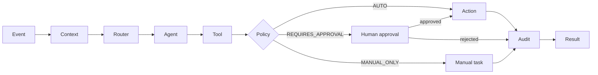

# Praxia Agent Core

**Build auditable, provider-independent AI workflows for real business operations.**

`Event → Context → Agent → Tool → Action → Audit`

Built from architectural patterns proven in real-world operational systems developed by Praxia.

[](https://github.com/praxia-atelier/praxia-agent-core/actions/workflows/ci.yml)


---

## Architecture



- **Event**: something happened (an email arrived, a lead was created).
- **Context**: business data loaded for that event (a CRM record, a price list).
- **Router**: picks a model provider for each task, with fallback.
- **Agent**: reasons and drafts. Agents never act directly.
- **Tool**: the only way to touch the outside world. Every tool declares a policy.
- **Action**: runs only if the policy allows it, after approval when required.
- **Audit**: every step is logged, without payloads or secrets.
- **Result**: a typed outcome, plus the audit trail and any manual actions.

## Why

Most AI integrations stop at "call a model". Real business processes need more:

- **The model is the least stable part.** Providers, prices and models change every quarter. Business workflows should name *tasks* (`classify`, `draft`), not vendors.
- **Some actions must never run on autopilot.** Classifying an email is fine. Sending a quote needs a human. Changing a price should not be automatable at all.
- **Someone will ask "why did the system do that?"** You need a trail of what ran, when, with which provider, and what was decided, without turning your logs into a store of personal data.

Praxia Agent Core is a small runtime that makes those three things the default.

Patterns used in production include document classification, email routing, sales workflows, quote generation and CRM automation. This repository is a clean, generic implementation inspired by production patterns. It contains no production code, prompts or data.

## Quick start

Requires Node.js 20.12 or newer. The demos run **offline** with a mock provider, so no API key is needed.

```bash
git clone https://github.com/praxia-atelier/praxia-agent-core.git
cd praxia-agent-core
npm install
npm run demo -- --approve
```

Run one demo interactively (you approve or reject actions in the terminal):

```bash
npm run demo:quote
```

Use a real model provider:

```bash
cp .env.example .env
# set PRAXIA_PROVIDER=anthropic (or openai, google, auto) and the matching API key
npm run demo:sales
```

## Core concepts

```ts
import {
  BasicRouter, AnthropicProvider, OpenAIProvider, createRuntime, createEvent,
  defineAgent, defineTool, defineWorkflow,
} from '@praxia/agent-core';

// 1. An agent reasons. It asks for a *task*, not a vendor.
const classify = defineAgent<{ text: string }, { category: string }>({
  name: 'classify',
  run: (input, ctx) =>
    ctx.completeJson<{ category: string }>('classify', {
      system: 'Classify the message as "billing", "support" or "other". Return {"category": ...}.',
      messages: [{ role: 'user', content: input.text }],
    }),
});

// 2. A tool acts. Its policy is enforced by the runtime, not by the workflow.
const openTicket = defineTool<{ category: string }, { id: string }>({
  name: 'open-ticket',
  description: 'Opens a ticket in the helpdesk',
  policy: 'REQUIRES_APPROVAL',
  execute: async () => ({ id: 'T-1' }),
  describe: (input) => `Open a ${input.category} ticket`,
});

// 3. A workflow is plain async code.
const triage = defineWorkflow({
  id: 'triage',
  accepts: ['message.received'],
  async run(ctx) {
    const { category } = await ctx.agent(classify, ctx.event.payload as { text: string });
    return ctx.tool(openTicket, { category });
  },
});

// 4. The runtime wires providers, approvals and audit.
const runtime = createRuntime({
  router: new BasicRouter({
    providers: [new AnthropicProvider(), new OpenAIProvider()],
    routes: { classify: ['openai', 'anthropic'] },
  }),
});

const result = await runtime.run(
  triage,
  createEvent({ type: 'message.received', source: 'web', payload: { text: 'My invoice is wrong' } }),
);
console.log(result.status, result.audit);
```

| Concept | Interface | Built-in implementations |
|---|---|---|
| Event | `BusinessEvent` | `createEvent()` |
| Context | `ContextLoader` | `staticContext()` |
| Provider | `ModelProvider` | `AnthropicProvider`, `OpenAIProvider`, `GoogleProvider`, `MockProvider` |
| Router | `ModelRouter` | `BasicRouter` (ordered routes + fallback) |
| Agent | `Agent` | `defineAgent()` |
| Tool | `Tool` | `defineTool()` |
| Approval | `ApprovalGate` | `ConsoleApprovalGate`, `DeferredApprovalGate`, `ScriptedApprovalGate` |
| Audit | `AuditSink` | `MemoryAuditLog`, `JsonlAuditLog`, `FanoutAuditSink` |

More in [docs/concepts.md](docs/concepts.md).

## Examples

All examples use fictional people, companies, prices and documents, and run offline by default.

| Example | Flow | Shows |
|---|---|---|
| [`inbox-agent`](examples/inbox-agent) | email → classify → invoice / quote / general → extract → mock record → audit | Classification, structured extraction, AUTO tools |
| [`sales-agent`](examples/sales-agent) | lead → mock enrichment → mock CRM context → analysis → email draft → approval → audit | Context loaders, read-only tools, human approval |
| [`quote-agent`](examples/quote-agent) | service request → interpret → price in code → draft → approval → audit | Deterministic pricing, catalog validation, MANUAL_ONLY |

## Providers

Adapters call each vendor's public HTTP API with `fetch`. There are no vendor SDKs and no runtime dependencies.

| Provider | Class | Environment variables |
|---|---|---|
| Anthropic | `AnthropicProvider` | `ANTHROPIC_API_KEY`, `ANTHROPIC_MODEL` |
| OpenAI (and compatible endpoints) | `OpenAIProvider` | `OPENAI_API_KEY`, `OPENAI_MODEL`, `OPENAI_BASE_URL` |
| Google Gemini | `GoogleProvider` | `GOOGLE_API_KEY`, `GOOGLE_MODEL` |
| Offline | `MockProvider` | none |

Adding a provider means implementing one interface with two methods. See [docs/providers.md](docs/providers.md).

## Human approval

Every tool declares one of three policies:

| Policy | Example | What the runtime does |
|---|---|---|
| `AUTO` | Classify an email | Executes |
| `REQUIRES_APPROVAL` | Prepare and send a quote | Asks the approval gate; executes only if approved |
| `MANUAL_ONLY` | Change a price | Never executes; reports a manual action |

Deployments can tighten any tool's policy with `policyOverrides` without touching code. Overrides can never loosen a policy. Without a configured gate, approval requests are rejected. See [docs/approvals.md](docs/approvals.md).

## Auditability

Each step writes an entry with `workflow_id`, `run_id`, `event`, `agent`, `tool`, `action`, `timestamp`, `status`, `result_summary` and `error`.

The audit log never stores event payloads, tool inputs or model output. Summaries describe *shape* unless you provide a `summarize()` function, and everything passes through a redaction filter for emails, phone numbers, keys and tokens. See [docs/audit.md](docs/audit.md).

## Security

- API keys come from environment variables only. They are never logged and never included in error messages.
- Agents cannot act. Only tools can, and only within their policy.
- `dryRun: true` skips every tool that is not explicitly read-only.
- The test suite runs fully offline. CI includes a secret scan and a dependency audit.

See [SECURITY.md](SECURITY.md) to report a vulnerability.

## Roadmap

| Version | Scope |
|---|---|
| **v0.1** | Core interfaces, providers, basic router, tools, approvals, audit, examples |
| v0.2 | Additional connectors, persistent run state, evaluations |
| v0.3 | Plugin system, observability hooks |

The core will stay small. See [docs/scope.md](docs/scope.md) for what is intentionally out of scope.

## Contributing

Issues and pull requests are welcome. Please read [CONTRIBUTING.md](CONTRIBUTING.md) first. Every contribution must run offline and use fictional data.

## License

[Apache License 2.0](LICENSE). The license does not cover the Praxia Atelier name or logos; see [TRADEMARKS.md](TRADEMARKS.md).

## About Praxia

Praxia builds intelligent operating systems for real businesses: systems where data, processes, agents, models, tools and actions work as one. Agent Core is the small, open part of that work.

[praxia-atelier.net](https://praxia-atelier.net)
